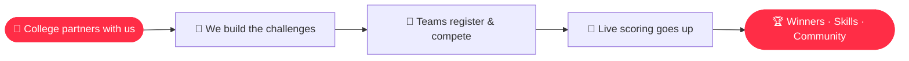

<!--
  SETUP
  1. Replace: GITHUB_USERNAME, LINKEDIN_HANDLE, EMAIL, REPO_ONE, REPO_TWO
  2. Create a public repo named exactly like your GitHub username.
  3. Put README.md and the assets/ folder (banner.svg, footer.svg, divider.svg) in it.
-->

<div align="center">
  
</div>

<p align="center">
  <a href="https://readme-typing-svg.demolab.com">
    
  </a>
</p>

<p align="center">
  <a href="https://www.kravexlabs.in/"></a>
  <a href="https://www.kravexlabs.in/"></a>
  <a href="https://linkedin.com/in/LINKEDIN_HANDLE"></a>
  <a href="mailto:EMAIL"></a>
  
</p>


## 👋 &nbsp;About Me

<table>
<tr>
<td width="62%" valign="top">

I'm **Vishesh Kumar**, Founder and CEO of **KRAVEX LABS**: a cyber range and CTF platform that helps colleges turn cybersecurity learning into **immersive Capture The Flag competitions** students remember.

Security is best learned under pressure, with a clock running and a scoreboard watching. I'm building the place where that happens: **hands-on, competitive, and fun**.

```yaml
name:      Vishesh Kumar
role:      Founder & CEO
company:   KRAVEX LABS          # Labs / Cyber Range
mission:   Cybersecurity, made competitive
building:  Campus CTFs · Live scoring · Hands-on challenges
open_to:   [College partnerships, Sponsors, Mentors, Collaborators]
status:    "shipping, always"
```

</td>
<td width="38%" align="center" valign="middle">

<br/><br/>
<br/><br/>
<br/><br/>


</td>
</tr>
</table>


## 🏁 &nbsp;What We Do at KRAVEX LABS

<table>
<tr>
<td align="center" width="25%"><h3>🚩</h3><b>Campus CTFs</b><br/><sub>Competitions built for colleges</sub></td>
<td align="center" width="25%"><h3>🧪</h3><b>Hands-on Challenges</b><br/><sub>Real problems, not slideshows</sub></td>
<td align="center" width="25%"><h3>📡</h3><b>Live Scoring</b><br/><sub>A real, live scoreboard</sub></td>
<td align="center" width="25%"><h3>🏆</h3><b>Leaderboards</b><br/><sub>Teams compete and climb</sub></td>
</tr>
</table>

### 🔁 &nbsp;How a Campus CTF Runs



### 🎯 &nbsp;Challenge Categories

<p align="center">
  
  
  
  
  
  
</p>

### 🔴 &nbsp;The Arena <sub>(illustrative sample)</sub>

| # | Team | Focus | Solves | Score |
|:-:|:--|:--|:-:|--:|
| 🥇 | `nullX` | Web · Pwn | 21 | **3,140** |
| 🥈 | `root_access` | Forensics · OSINT | 18 | **2,710** |
| 🥉 | `byte_bandit` | Reverse · Web | 15 | **2,190** |
| 04 | `kernel_9` | Crypto · Pwn | 12 | **1,870** |

<div align="center">

**Ready to run one on your campus?** &nbsp; [**Build your campus CTF ↗**](https://www.kravexlabs.in/)

</div>


## 🧭 &nbsp;How I Lead

<table>
<tr>
<td align="center" width="25%"><h3>🧠</h3><b>Vision</b><br/><sub>Make cyber learning competitive</sub></td>
<td align="center" width="25%"><h3>🛠️</h3><b>Product</b><br/><sub>Platform, challenges, scoreboard</sub></td>
<td align="center" width="25%"><h3>👥</h3><b>Team</b><br/><sub>Builders, hackers, educators</sub></td>
<td align="center" width="25%"><h3>📈</h3><b>Growth</b><br/><sub>Colleges, sponsors, community</sub></td>
</tr>
</table>


## 🧰 &nbsp;Tech & Tools

<p align="center">
  
</p>


## 🚀 &nbsp;Featured Repos

<table>
<tr>
<td width="50%" valign="top">

### 🔹 [REPO_ONE](https://github.com/GITHUB_USERNAME/REPO_ONE)
Short description of what it does.


</td>
<td width="50%" valign="top">

### 🔹 [REPO_TWO](https://github.com/GITHUB_USERNAME/REPO_TWO)
Short description of what it does.


</td>
</tr>
</table>


## 📊 &nbsp;GitHub Activity

<p align="center">
  
  
</p>

<p align="center">
  
</p>

<p align="center">
  
</p>


## 🤝 &nbsp;Let's Connect

Colleges, sponsors, mentors, and fellow builders: let's make cybersecurity learning something students are excited about.

<div align="center">

<a href="https://www.kravexlabs.in/"></a>
<a href="mailto:EMAIL"></a>
<a href="https://linkedin.com/in/LINKEDIN_HANDLE"></a>

<br/><br/>

<i>Real challenges. Real teamwork. Real progress.</i>



</div>
